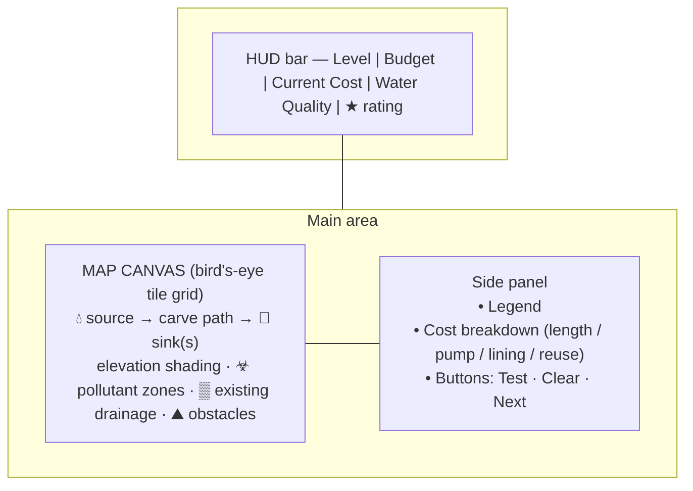

# Game Plan — "FlowPath: Sustainable Irrigation" (Deliverable 1)

**Status: PLAN ONLY — no game code will be written until you approve this and answer the open questions (§7).**
**Date: 2026-06-25**

> **Headline change you must sign off on:** Your concept says *"the shorter the path, the lower the cost and the more points."* Real irrigation engineering says cost is driven by **elevation lift and slope at least as much as length** — gravity moves water downhill for free, but pumping uphill burns energy/money, steep segments erode and need costly lining, and avoiding pollutants can force a *longer* path that is still the better choice. I propose to refine "shortest = cheapest" into **"lowest *total* cost,"** where total cost = construction(length) + pumping(uphill lift) + lining(steep/erosion segments) − reuse(existing drainage), with a separate water-quality requirement. This keeps "efficiency is rewarded" but makes it accurate and creates genuine trade-offs. **Sources in §4.** If you'd rather keep the simpler "length-only" rule, say so and I'll scope it down (but it would teach an inaccurate model).

---

## 1. Refined concept & core mechanic

### Refined CONCEPT
- **Theme/story/purpose:** You are a sustainable-irrigation planner. Each level is a different terrain archetype (highland terraces, farmland delta, arid lowland, etc.). Your job: route water from a **source** to one or more **farm sinks** by carving channels on a bird's-eye map — delivering enough clean water at the lowest total cost while respecting elevation, slope limits, and pollution.
- **Intended player experience:** A calm, puzzle-y "draw-test-refine" loop — like a routing/optimization puzzle. Satisfaction comes from finding a clever path that beats the obvious shortcut.
- **Driving challenge/problem:** The obvious shortest path is often **wrong** — it may climb uphill (pumping cost), cut through a pesticide zone (quality fail), or run too steep (erosion). The player must reconcile **cost, gravity/elevation, slope limits, and pollution** — the core tension of real sustainable irrigation.

### Refined CORE GAME MECHANIC
- **The repeated action (unchanged in spirit):** Click-and-drag across grid tiles to **carve a channel path** from source to sink; press **Test** to simulate flow; read the cost/quality feedback; **adjust and re-test** — unlimited attempts.
- **What I tightened and why:**
  | Original | Refined | Why |
  |---|---|---|
  | "Shortest path = lowest cost = most points" | **Lowest *total* cost** = length + uphill-pumping + steep-lining − drainage-reuse | Accurate to engineering; creates real trade-offs (§4). |
  | Elevation is a vague "variable element" | Elevation drives a concrete **gravity rule**: downhill = free flow; uphill = pumping cost (or blocked in gravity-only mode); a **slope band** (too-flat = no flow, too-steep = erosion) | Matches gravity-fed irrigation physics (§4). |
  | "Avoid pollutant sources" | Pollutant tiles have a **contamination radius**; routing through/near drops a **Water-Quality score**, and a direct hit can fail the level | Reflects how pesticide/agri-runoff contaminates conveyed water (§4). |
  | "Pre-established drainage systems" as backdrop | Reusing existing-drainage tiles gives a **cost credit** | Teaches using existing infrastructure — a real sustainability lever. |
  | Single path | Support **one OR multiple branches** to multiple sinks (your concept allowed "one or more") | Higher levels get richer; confirm in §7. |

---

## 2. Learning objectives (explicit & observable in gameplay)

Each LO is tied to an **in-game observable** — something you can see a player do, which doubles as research data.

| # | Learning objective | Observable in gameplay |
|---|---|---|
| LO1 | Explain that gravity-fed irrigation requires water to move **downhill** and that **lifting water uphill costs energy/money**. | Player avoids uphill segments, or accepts a visible pumping-cost penalty when they don't. |
| LO2 | Identify that **path length** is only one cost driver; **elevation and slope** matter too. | Player chooses a longer downhill route over a shorter uphill one and scores better. |
| LO3 | Recognize that channels **too steep erode** (need lining/drop structures) and **too flat won't flow** (need minimum gradient). | Player keeps segments inside the "ideal slope band"; sees erosion/no-flow failures otherwise. |
| LO4 | Explain how **pollutant sources (pesticides/agri-runoff)** degrade water quality and must be routed around. | Player detours around contamination radius; Water-Quality score responds. |
| LO5 | Evaluate **cost trade-offs** to reach a sustainable solution (clean water, adequate delivery, lowest total cost). | Player iterates toward a low-cost, high-quality solution across multiple test runs. |
| LO6 | Apply the value of **reusing existing drainage infrastructure**. | Player routes through existing-drainage tiles for the cost credit. |

> Note on the research frame: this game is *played* to learn, but in your study it is also a *designed artifact*. The LOs above are written so player choices are loggable (see §5 telemetry) — useful as study data if you want it.

---

## 3. Game-design spec

### 3.1 Grid & tile model
- **Bird's-eye tile grid** (proposed **16 × 12** tiles; tunable). Each tile has:
  - `elevation`: integer 0–9 (relative height; abstract units, not real metres — see §4 assumptions).
  - `type`: `source` (water start), `sink` (farm goal), `normal`, `pollutant`, `drainage` (reusable), `obstacle` (impassable: rock/urban/protected land).
  - Pollutant tiles carry a `contaminationRadius` (e.g., 1–2 tiles).
- **Connectivity:** 4-directional carving (orthogonal) for v1 clarity; 8-dir is an option (§7).

### 3.2 The "Test Path" simulation logic (simplified — assumptions stated)
When the player presses **Test**, water is released from the source and traced along the carved path tile-by-tile. For each segment between adjacent tiles A→B, compute `Δe = elev(B) − elev(A)`:

| Condition | Engineering meaning | Game effect |
|---|---|---|
| `Δe < 0` and within max drop | Gravity flow, ideal | Free flow; only construction cost |
| `Δe == 0` over a short run | Flat | Flows but flagged; long flat runs risk stalling (min-gradient rule) |
| `Δe > 0` (uphill) | Needs pumping | **Pumping cost** added ∝ lift; in *gravity-only mode* (§7) this **blocks** flow → fail |
| `Δe ≤ −steepThreshold` | Too steep → erosion/scour | **Lining cost** added per steep segment (or fail if unlined mode) |
| Segment inside a pollutant `contaminationRadius` | Water picks up pollutants | **Water-Quality** score drops; direct pass-through of a pollutant tile = **fail** |
| Segment on a `drainage` tile | Reuse existing infrastructure | **Reuse credit** (cost reduction) |

**Simplifying assumptions (flagged for your confirmation, §7):**
- A1. Discrete grid; integer "elevation units," not real metres. No real fluid dynamics — flow is a rule-based trace, not a physics sim.
- A2. "Enough water delivered" = the path connects source to all required sinks; no per-crop volume modeling in v1.
- A3. Weather (rain) modeled as a **modifier** (e.g., rain enlarges contamination radius / adds runoff), not a dynamic simulation, in v1.
- A4. Cost coefficients are **game-balance numbers**, not real currency.

### 3.3 Scoring / cost model
```
TotalCost = c_len·(pathLength)
          + c_pump·(Σ uphill lifts)
          + c_line·(# too-steep segments)
          − c_reuse·(# drainage tiles reused)

WaterQuality = 100 − Σ contamination penalties     (must stay ≥ qualityThreshold to win)

LevelScore   = BaseBudget − TotalCost + DeliveryBonus(all sinks reached)
              (clamped ≥ 0; quality below threshold = fail, not just low score)
```
- **Why this design:** rewards efficiency (your original intent) but makes the **shortest path frequently suboptimal**, forcing the LO trade-offs. Star rating (★/★★/★★★) by score band gives readable progress feedback.

### 3.4 Difficulty curve (one concept introduced per level)
| Level | Terrain archetype | New concept taught | LO focus |
|---|---|---|---|
| 1 (tutorial) | Gentle plain, all downhill, no pollutants | Carve + test; cost = length | LO1, LO2 |
| 2 | Rolling elevation | Uphill = pumping cost; pick downhill | LO1, LO2 |
| 3 | Farmland with a pesticide zone | Contamination radius; detour | LO4, LO5 |
| 4 | Steep highland | Slope band: erosion/lining + min-gradient | LO3 |
| 5 | Delta with old canals | Reuse existing drainage; rain modifier | LO6, LO3 |
| 6 | Combined, multiple sinks, tight budget | Integrate all; optimize | LO2, LO5 |

### 3.5 Win / lose & feedback loops
- **Win:** all required sinks connected, WaterQuality ≥ threshold, within budget → stars by score.
- **Lose/retry:** flow fails (uphill block in gravity-only mode, direct pollutant hit, or over budget) → clear inline message ("Water can't climb here — it needs a pump, or reroute downhill"). **Unlimited test/retry** (trial-and-error is core).
- **Feedback loops:** (1) live cost preview while dragging; (2) animated water on Test showing where it stalls/contaminates; (3) post-test **cost breakdown panel** (length vs pump vs lining vs reuse) so the player *sees why* a path scored as it did — this is where the learning happens.

---

## 4. Domain accuracy — verified vs. simplified

### Verified via web search (with sources)
| Fact used in design | Source |
|---|---|
| Gravity-fed irrigation requires the source **above** the use point; water flows downhill; ~**1 PSI per 2.31 ft** of elevation — establishes the gravity/elevation rule (LO1). | DripWorks; BlueBarrel Systems |
| **Drip ~90–95% efficient vs sprinkler ~60–70%** — supports "sustainable method" framing. | DripWorks |
| Irrigation cost is **dominated by capital (pumps, pipes) + energy to pump**; pump horsepower depends on **lift (elevation) and pipe length/friction** (total dynamic head) — basis for the pumping-cost term. | Univ. of Nebraska–Lincoln irrigation course (Ch.13); Michigan State Extension |
| Agricultural pollutants = **sediment, nutrients, pathogens, pesticides, metals, salts**; **pesticides enter water via runoff**, worsened by over-irrigation — basis for pollutant tiles + quality penalty (LO4). | US EPA (Ag Runoff fact sheet); USGS Agricultural Contaminants |
| Irrigation channel slope is normally **very gentle (~0.0001–0.001 m/m)** on flat land; **too steep → erosion/scour** (needs lining/drop structures), with **max permissible velocities** to avoid erosion — basis for the slope band + lining cost (LO3). | FAO water-transport-structures; open-channel design manuals |

### Simplified for playability (intentional, not errors)
- Discrete tile grid + integer elevation units instead of metres (A1).
- Rule-based flow trace instead of real hydraulics (A1).
- Single "water quality" number instead of per-pollutant chemistry (A3).
- Weather as a modifier, not a dynamic model (A3).
- Abstract cost units, not real currency (A4).

### Open domain questions for you (also in §7)
- **Q-D1.** Gravity-only (uphill = impossible) vs. allow pumping with a cost? I recommend **allow pumping with cost** (teaches the trade-off richly). Confirm.
- **Q-D2.** Do you want **real named locations** (e.g., a specific valley/region)? If yes, I will **verify each location's** real elevation/pollutant facts before asserting them — I will **not** invent geography. Default proposal: **representative archetypes** labelled "illustrative," which avoids false claims about real places.
- **Q-D3.** Represent a specific method (canal vs. drip) explicitly, or keep an abstract "water path"? Abstract is simpler; canal-vs-drip could be a later mechanic.

---

## 5. Technical plan (web)

### Stack (kept deliberately simple)
- **Vanilla HTML5 + CSS + JavaScript**, rendering the map on a **`<canvas>`** (best for grid drawing + drag-carving + water animation). **No build step, no framework** → runs by opening a file or a one-line local server.
- *Rationale:* lowest friction to run/modify on your Windows machine; no dependency install; easy to hand to collaborators.

### Proposed file structure (all under `D:\ClaudeProjects\Games_02`)
```
Games_02/
  index.html
  css/
    style.css
  js/
    main.js          // bootstrap, game loop, input handling
    grid.js          // tile model, rendering, coordinate math
    levels.js        // level definitions (elevation maps, pollutants, sinks)
    simulation.js    // test-path flow trace + cost/quality calculation
    ui.js            // HUD, cost breakdown panel, buttons, messages
  assets/
    (icons/legend, optional)
  README.md          // how to run
```

### How carving + cost calc work
- **Carving:** `mousedown` starts a path at the clicked tile (must be source or an existing path tile); `mousemove` appends each newly-entered adjacent, passable tile; `mouseup` ends. Live cost preview updates during drag. "Clear" resets.
- **Cost calc:** on **Test**, iterate the ordered path, apply the §3.2 rules, accumulate the §3.3 cost/quality, animate water, then render the breakdown.
- **(Optional) Telemetry for your study:** log each Test attempt (path, cost, quality, pass/fail) to a downloadable JSON — gives you player-decision data. *Off by default; turn on if wanted (§7).*

### How it runs locally
- Simplest: double-click `index.html`. If browser security blocks `file://` module loading, run a one-liner static server (I'll document both in README). No internet needed at play time.

---

## 6. UI / UX & accessibility outline

### Bird's-eye layout (mockup)


ASCII sketch of the map idea:
```
 ░░░░░☣☣░░░░░░░░     💧 = water source     🌱 = farm sink
 ░░▒▒▒░☣░░⛰⛰░░░░     ☣  = pollutant (avoid radius)
 💧──┐░░░░░⛰░░░░░     ▒  = existing drainage (reuse credit)
 ░░░└──┐░░░░░░🌱░     ⛰  = obstacle (impassable)
 ░░░░░░└───────┘     shading = elevation (light=high, dark=low)
```

### Controls
- **Mouse:** click-drag to carve, click **Test/Clear/Next**. Hover tooltips on tiles (elevation, type).
- **Keyboard alternative:** proposed but **needs confirmation** (accessibility, §7) — arrow keys to move a cursor + space to carve.

### Color / contrast (accessibility)
- **Colorblind-safe:** never rely on red/green alone. Pollutant = magenta **+ ☣ icon + hatch pattern**; sink = green **+ 🌱 icon**; source = blue **+ 💧 icon**. Elevation = a **single-hue sequential shade** (not a rainbow) plus optional contour numbers.
- **Contrast:** target **WCAG 2.1 AA** for text/UI (≥ 4.5:1). Tile labels and HUD use high-contrast text.
- **Redundant encoding:** every meaningful color also has an icon, pattern, or text label.
- *Honesty note:* I don't have an automated accessibility-audit skill in this session; I'll apply these by hand and you can spot-check. If you need a formal audit, that's a separate pass.

---

## 7. Open questions & assumptions to confirm (please answer before I build)

### Decisions that change the build
1. **Q1 — Pumping:** Gravity-only (uphill blocked) **or** allow pumping with a cost? *(I recommend: allow pumping with cost.)*
2. **Q2 — Locations:** Representative archetypes labelled "illustrative" *(my default)* **or** real named places (I'll verify each)?
3. **Q3 — Players/level:** Who plays, and at what level (your students? general public? age/grade)? Affects text density, difficulty, and reading load.
4. **Q4 — Paths:** Single path only, or multiple branches to multiple sinks? *(I recommend single in L1–3, branching from L4.)*
5. **Q5 — Number of levels for the study:** I propose **6**. OK?
6. **Q6 — Win strictness:** Must reach **all** sinks, or maximize coverage within budget?
7. **Q7 — Weather depth:** Simple modifier *(my default)* or a deeper dynamic system?
8. **Q8 — Telemetry:** Do you want per-attempt logging exported as JSON for your research data? *(Off by default.)*
9. **Q9 — Accessibility scope:** Is keyboard-only / screen-reader support required for v1, or is mouse-first acceptable?
10. **Q10 — Method representation (Q-D3):** Abstract "water path" *(my default)* or explicit canal-vs-drip mechanic?

### Assumptions I'm making unless you object
- A1 Discrete grid, integer elevation units, rule-based flow (no real hydraulics).
- A2 "Delivery" = connectivity to sinks; no per-crop volume in v1.
- A3 Weather/quality simplified to modifiers/single score.
- A4 Cost units are game-balance numbers, not currency.
- A5 Vanilla HTML/CSS/JS + Canvas, no framework, runs locally with no install.
- A6 16×12 grid, 4-directional carving, 6 levels — all tunable.

---

**Next step:** I will **stop here and wait** for your approval + answers to §7. On approval, I'll implement the game in `D:\ClaudeProjects\Games_02` per this spec and tell you exactly how to run it.

*Sources consulted (for §4):* DripWorks (gravity-fed drip; efficiency); BlueBarrel Systems (gravity/elevation PSI rule); University of Nebraska–Lincoln Irrigation Home Study Course Ch.13 (pumping energy cost); Michigan State Extension (pump selection); US EPA Agricultural Runoff fact sheet; USGS Agricultural Contaminants; FAO water-transport structures + open-channel design manuals (slope/erosion). Full URLs available on request or I can add a `sources` section to match the earlier `sources.doc` format.
